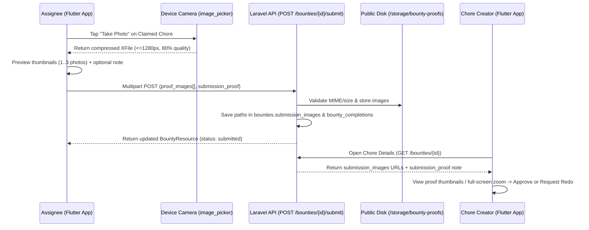

# Chore Submission Camera Proof Plan

## 1. Objective
Add camera-based image proof to the chore submission workflow in **ChoreBounty**. Before an assignee submits a claimed chore for review, they capture one or more photos (up to 3) using their device camera and optionally include a short note. The chore creator then reviews the submitted photos and note on the Chore Details screen before approving the chore or requesting a redo.

---

## 2. Current Codebase Baseline

| Layer | File | Current Behavior |
| :--- | :--- | :--- |
| **Database (`bounties`)** | `chore-bounty-api/database/migrations/2026_10_23_200000_add_quest_fields_to_bounties_table.php` | Stores text-only `submission_proof` (`TEXT NULL`). |
| **Database (`bounty_completions`)** | `chore-bounty-api/database/migrations/2026_10_12_081855_create_bounty_completions_table.php` | Stores `submission_note` (`TEXT NULL`) and `proof_url` (`VARCHAR(2048) NULL`). |
| **API Validation** | `chore-bounty-api/app/Http/Requests/SubmitBountyRequest.php` | Validates `submission_proof`, `proof_url`, and `note` as strings only. |
| **API Controller** | `chore-bounty-api/app/Http/Controllers/BountyActionController.php` | `submit()` writes text `submission_proof` to `bounties` and `submission_note` to `bounty_completions`. |
| **API Resource** | `chore-bounty-api/app/Http/Resources/BountyResource.php` | Exposes `submission_proof` string; does not expose proof image URLs. |
| **Flutter Model** | `chore_bounty_application/lib/models/bounty.dart` | Parses `submissionProof` (`String?`); has no image list field. |
| **Flutter Service** | `chore_bounty_application/lib/services/bounty_service.dart` | `submit(String id, {String? proof})` sends a JSON payload with `submission_proof`. |
| **Flutter UI** | `chore_bounty_application/lib/screens/bounty_detail_screen.dart` | Renders a text `TextField` (`Submission Note / Proof`) for assignees and a text-only `Proof Submitted` box in `_buildClaimantSection()`. |

---

## 3. Recommended Free Tools & Libraries

1. **`image_picker` (`^1.1.2`, Flutter Official Plugin, BSD-3-Clause)**
   - Provides native camera capture (`ImageSource.camera`) and gallery selection (`ImageSource.gallery`) on Android and iOS.
   - Supports built-in resize and JPEG compression (`maxWidth: 1280`, `maxHeight: 1280`, `imageQuality: 80`) during capture, reducing 4–8 MB camera photos to ~150–250 KB without extra native compression packages.
2. **Laravel Public Storage Disk (`Storage::disk('public')`)**
   - Uses Laravel's built-in local filesystem driver and `php artisan storage:link` to serve uploaded proof images from `/storage/bounty-proofs/{household_id}/{bounty_id}/` with zero external cloud storage cost.
3. **Flutter `InteractiveViewer` (Built into Flutter SDK)**
   - Provides pinch-to-zoom and pan inspection of submitted proof photos inside a modal dialog without third-party gallery dependencies.

---

## 4. End-to-End Submission Flow



---

## 5. Backend Implementation Plan (`chore-bounty-api`)

### 5.1 Database Migration
Create `database/migrations/2026_11_15_000000_add_submission_images_to_bounties_table.php`:
- Add `submission_images` (`json`, nullable) after `submission_proof` on `bounties`.
- Add `proof_images` (`json`, nullable) after `proof_url` on `bounty_completions`.

### 5.2 Model Updates
- **[Bounty.php](file:///d:/www/chore-bounty/chore-bounty-api/app/Models/Bounty.php)**:
  - Add `'submission_images'` to `$fillable`.
  - Add `'submission_images' => 'array'` in `casts()`.
- **[BountyCompletion.php](file:///d:/www/chore-bounty/chore-bounty-api/app/Models/BountyCompletion.php)**:
  - Add `'proof_images'` to `$fillable`.
  - Add `'proof_images' => 'array'` in `casts()`.

### 5.3 Request Validation (`SubmitBountyRequest.php`)
Update [SubmitBountyRequest.php](file:///d:/www/chore-bounty/chore-bounty-api/app/Http/Requests/SubmitBountyRequest.php) rules:
```php
public function rules(): array
{
    return [
        'submission_proof' => ['nullable', 'string', 'max:1000'],
        'note' => ['nullable', 'string', 'max:1000'],
        'proof_url' => ['nullable', 'string', 'max:2048'],
        'proof_images' => ['nullable', 'array', 'max:3'],
        'proof_images.*' => ['file', 'image', 'mimes:jpg,jpeg,png,webp', 'max:5120'],
    ];
}
```

### 5.4 Controller Storage & Cleanup (`BountyActionController.php`)
Update [BountyActionController.php](file:///d:/www/chore-bounty/chore-bounty-api/app/Http/Controllers/BountyActionController.php):
- In `submit(SubmitBountyRequest $request, Bounty $bounty)`:
  1. Authorize via `Gate::authorize('submit', $bounty)`.
  2. Store each uploaded file in `$request->file('proof_images', [])` on the `public` disk under `bounty-proofs/{$bounty->household_id}/{$bounty->id}`.
  3. Save the array of stored relative paths (e.g., `["/storage/bounty-proofs/2/14/uuid.jpg"]`) to `bounties.submission_images` and `bounty_completions.proof_images` (setting `proof_url` to the first image path for backward compatibility).
  4. Save the optional text note to `submission_proof` (defaulting to `'Photo proof submitted'` when photos are attached and text is blank).
- In `reject(ReviewBountyRequest $request, Bounty $bounty)`:
  1. When the creator requests a redo, delete the previous files in `$bounty->submission_images` from `Storage::disk('public')` and reset `submission_images` and `submission_proof` to `null` so the assignee starts fresh.

### 5.5 Resource Serialization (`BountyResource.php`)
Update [BountyResource.php](file:///d:/www/chore-bounty/chore-bounty-api/app/Http/Resources/BountyResource.php):
- Add `'submission_images'` to `toArray(Request $request)`, mapping stored paths to full URLs using `$request->getSchemeAndHttpHost()` so both `http://10.0.2.2:8000` (Android emulator) and `http://127.0.0.1:8000` resolve images without host mismatches.

---

## 6. Frontend Implementation Plan (`chore_bounty_application`)

### 6.1 Dependencies & Native Permissions
1. **[pubspec.yaml](file:///d:/www/chore-bounty/chore_bounty_application/pubspec.yaml)**:
   - Add `image_picker: ^1.1.2` under `dependencies`.
2. **[AndroidManifest.xml](file:///d:/www/chore-bounty/chore_bounty_application/android/app/src/main/AndroidManifest.xml)**:
   ```xml
   <uses-permission android:name="android.permission.CAMERA" />
   <uses-feature android:name="android.hardware.camera" android:required="false" />
   ```
3. **iOS `ios/Runner/Info.plist`**:
   - Add `NSCameraUsageDescription` (`"ChoreBounty needs camera access so you can take photo proof of completed chores."`) and `NSPhotoLibraryUsageDescription`.

### 6.2 Model & Service Updates
1. **[bounty.dart](file:///d:/www/chore-bounty/chore_bounty_application/lib/models/bounty.dart)**:
   - Add `final List<String> submissionImages;` (`default = const []`) to `Bounty`.
   - Parse `submission_images` in `Bounty.fromJson`, normalizing relative `/storage/...` URLs against the active API origin.
2. **[bounty_service.dart](file:///d:/www/chore-bounty/chore_bounty_application/lib/services/bounty_service.dart)**:
   - Update `submit`:
     ```dart
     Future<void> submit(
       String id, {
       String? proof,
       List<String> imagePaths = const [],
     }) async
     ```
   - When `imagePaths.isNotEmpty`, construct `FormData` with `MultipartFile.fromFile(path)` entries under `proof_images[]` and `submission_proof`, and post to `/bounties/$id/submit`.

### 6.3 Reusable UI Widgets & Design System Alignment
Match existing ChoreBounty design tokens:
- Surface background: `#FAF8F5`
- Card container: `#FFFFFF`, `BorderRadius.circular(20)`, border `1.2px solid #E2E8F0`
- Primary accent: `#1B8354` (green), subtle tint `#ECFDF5`
- Typography: `#0F172A` (headings), `#64748B` (secondary labels), `#DC2626` (validation/remove)

Create two focused, reusable widgets under `lib/widgets/bounty_detail/`:

1. **`bounty_proof_input_card.dart` (`BountyProofInputCard`)**
   - Shown in [bounty_detail_screen.dart](file:///d:/www/chore-bounty/chore_bounty_application/lib/screens/bounty_detail_screen.dart#L761-L812) when `_bounty.isClaimed && _isAssignee`.
   - **Header row**: Title `"Submission Proof"` + counter pill `"X / 3 Photos"` (`Required`).
   - **Action buttons**:
     - Primary button: `"Open Camera"` (`Icons.camera_alt_rounded`) calling `ImagePicker().pickImage(source: ImageSource.camera, maxWidth: 1280, maxHeight: 1280, imageQuality: 80)`.
     - Secondary button: `"Gallery"` (`Icons.photo_library_outlined`) calling `ImagePicker().pickImage(source: ImageSource.gallery, maxWidth: 1280, maxHeight: 1280, imageQuality: 80)`.
   - **Selected photo strip**: Horizontal row of `80x80` rounded (`12px`) image previews (`Image.file`), each with a top-right remove badge (`Icons.close_rounded`) and tap-to-preview dialog.
   - **Optional note field**: Compact 2-line `TextField` (`"Add an optional note (e.g., Wiped counters and took out trash)"`).
   - **Pre-submit validation**: Tapping `"Submit for Review"` without at least 1 attached photo displays an inline validation message (`"Please take at least one photo as proof before submitting."`).

2. **`bounty_proof_gallery.dart` (`BountyProofGallery`)**
   - Embedded inside `_buildClaimantSection()` in [bounty_detail_screen.dart](file:///d:/www/chore-bounty/chore_bounty_application/lib/screens/bounty_detail_screen.dart#L299-L315) when `_bounty.isSubmitted || _bounty.isCompleted`.
   - Renders a responsive row of `84x84` rounded thumbnails for `_bounty.submissionImages` above the submission note.
   - Tapping any thumbnail opens a full-screen dialog with `InteractiveViewer` and a close button so the chore creator can inspect details before tapping **Approve & Disburse Reward** or **Request Redo**.

---

## 7. Verification & Testing Plan

### 7.1 Backend Automated Tests (`chore-bounty-api`)
Add tests in `tests/Feature/ChoreStateAndIntegrityTest.php`:
1. `Storage::fake('public')` + `UploadedFile::fake()->image('proof1.jpg')`: Verify `POST /api/bounties/{id}/submit` stores up to 3 images, transitions status to `submitted`, and returns `submission_images` URLs in `BountyResource`.
2. Verify files exceeding 5 MB, non-image MIME types, or more than 3 images return `422 Unprocessable Entity`.
3. Verify `POST /api/bounties/{id}/reject` deletes the old proof images from storage and resets `submission_images` to `null`.

### 7.2 Frontend Automated Tests (`chore_bounty_application`)
Add tests in `test/features_and_fixes_test.dart`:
1. Injectable photo picker callback in `BountyDetailScreen` / `BountyProofInputCard`:
   - Tapping `"Submit for Review"` with 0 photos shows the required photo error and does not call `service.submit`.
   - Capturing a photo via `"Open Camera"` renders the thumbnail, allows removal, and submits `imagePaths` + note to `BountyService.submit`.
2. Verify `BountyProofGallery` renders network image thumbnails when `submissionImages` is populated on `Awaiting Review` and `Completed` chores.

### 7.3 Deployment Checklist
1. Run `php artisan migrate` and `php artisan storage:link` in `chore-bounty-api`.
2. Run `php artisan test`, `flutter analyze`, and `flutter test`.
3. Build and install debug APK (`flutter build apk --debug --target-platform android-x64 --dart-define=API_BASE_URL=http://10.0.2.2:8000/api`) on `emulator-5554` and verify the end-to-end camera capture, upload, and creator review flow.
