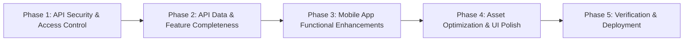

# ChoreBounty System Analysis & Implementation Runbook

## 1. Executive Summary

This document presents a full-stack audit of the **ChoreBounty** platform—covering the **Laravel 13 REST API** (`chore-bounty-api`) and the **Flutter 3.10 Mobile Application** (`chore_bounty_application`)—followed by a phased, step-by-step **Implementation Runbook**.

### Audit Scope
- **Backend API (`chore-bounty-api`)**: Routes, controllers, form requests, policies, Eloquent models, resources, services, migrations, and Sanctum configuration.
- **Mobile Application (`chore_bounty_application`)**: Network client, secure storage, services, domain models, screens, reusable widgets, and bundled assets.

### Key Findings Summary
| Category | Critical / High | Medium | Low | Total |
| :--- | :---: | :---: | :---: | :---: |
| **Security Vulnerabilities** | 5 | 4 | 2 | **11** |
| **Functionality & Data Integrity Gaps** | 4 | 5 | 2 | **11** |
| **UI/UX & Performance Improvements** | 2 | 4 | 3 | **9** |

---

## 2. Security Vulnerabilities Audit

### 2.1 Critical & High Severity Vulnerabilities

#### SEC-01: Broken Object-Level Authorization (IDOR) on User Profiles (Critical)
- **Location**: `chore-bounty-api/app/Http/Controllers/UserController.php` (Lines 25–43)
- **Evidence**:
  - In `show(User $user)`: `// $this->authorize('view', $user);` is commented out.
  - In `update(Request $request, User $user)`: `// $this->authorize('update', $user);` is commented out, and no `UserPolicy` exists in `app/Policies/`.
- **Impact**: Any authenticated user can send `PUT /api/users/{any_user_id}` to overwrite another user's `name` or `avatar`, or call `GET /api/users/{any_user_id}` to enumerate users across all households and view their email addresses, bounties, and redemptions.
- **Remediation**:
  1. Create `app/Policies/UserPolicy.php` enforcing `$authUser->id === $targetUser->id` for `update`, and shared household membership (`$authUser->id === $targetUser->id` or shared `household_user` row) for `view`.
  2. Uncomment and enforce `$this->authorize('view', $user)` and `$this->authorize('update', $user)` in `UserController`.

#### SEC-02: Broken Access Control on Household Membership Management (Critical)
- **Location**: `chore-bounty-api/app/Http/Controllers/HouseholdUserController.php` (Lines 31–64)
- **Evidence**:
  - In `store(Request $request, Household $household)`: `// $this->authorize('manageMembers', $household);` is commented out. Worse, the request validates `'role' => ['required', Rule::in(['owner', 'member'])]`, allowing any authenticated user to add themselves or any `user_id` to any household as an `owner`.
  - In `destroy(HouseholdUser $householdUser)`: `// $this->authorize('manageMembers', $household);` is commented out, allowing any authenticated user to remove any member from any household by guessing/iterating pivot IDs (`DELETE /api/household-users/{id}`).
- **Impact**: Complete privilege escalation and cross-tenant household takeover.
- **Remediation**:
  1. Create `app/Policies/HouseholdPolicy.php` defining `view`, `update`, `delete`, and `manageMembers` (requiring the actor to belong to the household and hold `'role' === 'owner'` or `created_by === $user->id`).
  2. Enforce `Gate::authorize('manageMembers', $household)` in `HouseholdUserController@store` and `HouseholdUserController@destroy`.
  3. Prevent removing the household owner via `HouseholdUserController@destroy`.

#### SEC-03: Unprotected Legacy Claim, Completion, and Redemption Endpoints (High)
- **Location**:
  - `chore-bounty-api/app/Http/Controllers/BountyClaimController.php` (Lines 28, 69, 78)
  - `chore-bounty-api/app/Http/Controllers/BountyCompletionController.php` (Lines 76–79, 95–98)
  - `chore-bounty-api/app/Http/Controllers/RewardRedemptionController.php` (Lines 68–72, 83–86)
- **Evidence**:
  - `BountyClaimController@destroy`: `// $this->authorize('release', $bountyClaim);` is commented out. Any authenticated user can release another user's active claim (`DELETE /api/bounty-claims/{id}`).
  - `BountyCompletionController@update`: `// $this->authorize('review', $bountyCompletion->claim->bounty);` is commented out. Any authenticated user—including the claimant themselves or a user from another household—can send `PATCH /api/bounty-completions/{id}` with `{"status": "approved"}` to self-approve their own chore and award themselves points.
  - `RewardRedemptionController@show` & `update`: Authorization checks are commented out, allowing any user to view or mark another user's reward as redeemed.
- **Impact**: Self-approval of bounties, cross-household tampering with active claims, and unauthorized reward status manipulation.
- **Remediation**:
  1. Enforce `Gate::authorize('verify', $bountyCompletion->claim->bounty)` in `BountyCompletionController@update` and `Gate::authorize('view', $bountyCompletion->claim->bounty)` in `show`.
  2. Enforce `Gate::authorize('release', $bountyClaim->bounty)` in `BountyClaimController@destroy` and `Gate::authorize('view', $bountyClaim->bounty)` in `show`.
  3. Uncomment and enforce ownership/creator checks in `RewardRedemptionController@show` and `update`.

#### SEC-04: Missing Logout / Token Revocation Endpoint (High)
- **Location**:
  - `chore-bounty-api/routes/api.php`
  - `chore-bounty-api/app/Http/Controllers/AuthController.php`
  - `chore_bounty_application/lib/services/auth_service.dart` ( Line 136: `logout()` only clears local storage)
- **Evidence**: `AuthController` has `register`, `login`, and `me`, but no `logout` method. When a user signs out on the mobile app, `TokenStorage.clear()` deletes the token locally, but the Sanctum personal access token remains permanently valid in `personal_access_tokens` (`config/sanctum.php` sets `'expiration' => null`).
- **Impact**: Compromised or intercepted bearer tokens cannot be invalidated by logging out and never expire.
- **Remediation**:
  1. Add `POST /api/auth/logout` in `routes/api.php` and `AuthController@logout` calling `$request->user()->currentAccessToken()->delete()`.
  2. Update `AuthService.logout()` in Flutter to call `POST /auth/logout` inside a `try/finally` block before clearing `TokenStorage`.
  3. Set a sensible token expiration in `config/sanctum.php` (e.g., `60 * 24 * 30` for 30 days) and prune old tokens on login if appropriate.

#### SEC-05: Missing Rate Limiting on Authentication & Invite Code Endpoints (High)
- **Location**: `chore-bounty-api/routes/api.php` (Lines 16–20, 29)
- **Evidence**:
  - `POST /api/auth/login` and `POST /api/auth/register` have no `throttle` middleware applied.
  - `POST /api/households/join` (`HouseholdController@joinByCode`) has no rate limiter and returns `404 Invalid invite code. No household found with code: ...`.
- **Impact**: Brute-force credential stuffing on `/api/auth/login` and automated enumeration of 8-character household invite codes on `/api/households/join`.
- **Remediation**:
  1. Apply `middleware('throttle:10,1')` to `/api/auth/login` and `/api/auth/register`.
  2. Apply `middleware('throttle:15,1')` to `/api/households/join`.

---

### 2.2 Medium & Low Severity Vulnerabilities

#### SEC-06: Any Household Member Can Rename the Household (`HouseholdController@update`)
- **Location**: `chore-bounty-api/app/Http/Controllers/HouseholdController.php` (Lines 62–77)
- **Evidence**: `update()` only checks if the user is a member of the household (`$household->members()->where('users.id', $request->user()->id)->exists()`), whereas `destroy()` checks `$household->created_by === $request->user()->id`.
- **Remediation**: Restrict `HouseholdController@update` to the household owner (`created_by === $request->user()->id` or pivot `role === 'owner'`).

#### SEC-07: Self-Completion Bypass in `BountyActionController@complete`
- **Location**:
  - `chore-bounty-api/app/Policies/BountyPolicy.php` (Lines 92–104)
  - `chore-bounty-api/app/Http/Controllers/BountyActionController.php` (Lines 108–144)
- **Evidence**: `POST /api/bounties/{bounty}/complete` is authorized by `BountyPolicy@complete`, which returns `Response::allow()` if `$isAssignee || $isCreator`. When called by the assignee, `BountyActionController@complete` sets `'status' => 'completed'` and approves any pending completion (`'status' => 'approved'`), bypassing the creator's verification (`submit` -> `verify`).
- **Remediation**: Restrict `BountyPolicy@complete` and `BountyActionController@complete` to the bounty creator (`$isCreator`), while assignees must use `POST /api/bounties/{bounty}/submit`.

#### SEC-08: Unnecessary PII Exposure (`email`) in Shared Household & Bounty Responses
- **Location**: `chore-bounty-api/app/Http/Resources/UserResource.php` (Line 13)
- **Evidence**: `UserResource` unconditionally returns `'email' => $this->email` for every creator, assignee, and roommate list item.
- **Remediation**: Only expose `email` when `$request->user()?->id === $this->id`, or omit `email` from public/roommate representations (`UserDetailScreen` only displays name, avatar, role, household, and join date).

#### SEC-09: Arbitrary String Accepted for `avatar` Field in `UserController@update`
- **Location**: `chore-bounty-api/app/Http/Controllers/UserController.php` (Line 38)
- **Evidence**: `'avatar' => ['sometimes', 'nullable', 'string', 'max:100']` accepts any arbitrary path or string rather than validating against allowed avatar identifiers (`default_profile.png`, `Gal 1.jpg`–`Gal 5.jpg`, `Guy 1.jpg`–`Guy 5.jpg`).
- **Remediation**: Validate `avatar` using `Rule::in([...])` or a safe filename regex `/^[A-Za-z0-9 _.-]+\.(png|jpg|jpeg)$/i`.

#### SEC-10: Hardcoded Cleartext HTTP Endpoint in Mobile Client
- **Location**: `chore_bounty_application/lib/core/api_client.dart` (Line 10)
- **Evidence**: `static const baseUrl = 'http://10.0.2.2:8000/api';` is hardcoded to cleartext HTTP on the Android emulator loopback address.
- **Remediation**: Use `String.fromEnvironment('API_BASE_URL', defaultValue: 'http://10.0.2.2:8000/api')` so production builds can inject an HTTPS URL via `--dart-define=API_BASE_URL=https://...` without source changes.

#### SEC-11: Global 401 Interceptor Missing in `ApiClient`
- **Location**: `chore_bounty_application/lib/core/api_client.dart` (Lines 20–36)
- **Evidence**: `ApiClient` attaches `Authorization` and `X-Household-Id` headers on request, but has no `onError` interceptor to handle `401 Unauthorized` responses when a token is revoked or expired while the app is open.
- **Remediation**: Add an `onError` handler in `InterceptorsWrapper` that clears `TokenStorage` on `401` responses (excluding `/auth/login` and `/auth/register`) and notifies the auth state listener to redirect to `WelcomeScreen`.

---

## 3. Functionality & Data Integrity Gaps

### 3.1 Backend & API Functionality Gaps

#### FUNC-01: Bounty List Truncated at 20 Items (`paginate(20)` vs Client Fetch)
- **Location**:
  - `chore-bounty-api/app/Http/Controllers/BountyController.php` (Line 36: `->paginate(20)`)
  - `chore_bounty_application/lib/services/bounty_service.dart` (Lines 10–17: `all()` only requests `/bounties` page 1)
- **Impact**: Once a household creates more than 20 bounties (including completed and cancelled history), older bounties disappear from `DashboardView`, `ChoresView`, `ProfileView`, and `UserDetailScreen`, and client-side completed counts in `ProfileView`/`UserDetailScreen` become inaccurate.
- **Remediation**:
  1. Allow `per_page` query parameter in `BountyController@index` (e.g., up to `100`, defaulting to `100` for household boards) and optional `status` filter.
  2. Support pagination or higher `per_page` in `BountyService.all()`.

#### FUNC-02: Leaderboard Time-Period Filter (`This Week` / `This Month`) is UI-Only
- **Location**:
  - `chore_bounty_application/lib/screens/leaderboard_view.dart` (Lines 35, 118–132: `_selectedPeriod` toggles state between `0` and `1` without re-querying or filtering)
  - `chore-bounty-api/app/Http/Controllers/LeaderboardController.php` & `app/Services/LeaderboardService.php`
- **Impact**: Tapping **This Week** vs **This Month** on the Leaderboard page changes the active pill highlight, but displays identical all-time totals.
- **Remediation**:
  1. Update `LeaderboardController@index` and `LeaderboardService::getHouseholdLeaderboard(Household $household, ?string $period = null)` to accept `?period=week|month|all`.
  2. Filter `completed_at` by `now()->startOfWeek()` for `week` and `now()->startOfMonth()` for `month`.
  3. Pass `period` from `HouseholdService.getLeaderboard(householdId, {String period = 'week'})` and trigger `_loadLeaderboard()` when the user switches tabs in `LeaderboardView`.

#### FUNC-03: Status Enum Mismatch Between Dual Claim Flows (`claimed` vs `in_progress`)
- **Location**:
  - `chore-bounty-api/app/Http/Controllers/BountyActionController.php` (Line 27: sets `'status' => 'claimed'`)
  - `chore-bounty-api/app/Http/Controllers/BountyClaimController.php` (Line 57: sets `'status' => 'in_progress'`)
  - `chore-bounty-api/app/Services/LeaderboardService.php` (Line 23: checks `whereIn('status', ['claimed', 'submitted'])`, missing `'in_progress'`)
- **Impact**: If a claim is created via `BountyClaimController`, `assignee_id` is not set on `bounties` and status becomes `'in_progress'`, causing `LeaderboardService` to miscount active bounties.
- **Remediation**: Standardize status transitions across `BountyClaimController` and `BountyActionController` (always set `assignee_id`, `claimed_at`, and `'status' => 'claimed'`, and include `'in_progress'` in `LeaderboardService` for backward compatibility).

#### FUNC-04: Category Not Persisted on `bounties` Table
- **Location**:
  - `chore-bounty-api/app/Models/Bounty.php` (Lines 60–88)
  - `chore_bounty_application/lib/screens/create_bounty_screen.dart` (Line 95: sends `'category': _selectedCategory`)
- **Impact**: The user explicitly selects a category (`Cleaning`, `Laundry`, `Kitchen`, `Groceries`, `Maintenance`, `Other`) in `CreateBounty`, and sends `'category'` in the JSON payload. However, `bounties` has no `category` column; `Bounty.php` guesses the category by keyword-matching the title and description! If a user posts `"Help me out"` under `Laundry`, it displays as `Other`.
- **Remediation**:
  1. Add a migration adding a nullable `category` string column to `bounties`.
  2. Add `'category'` to `Bounty::$fillable`, `StoreBountyRequest`, and `UpdateBountyRequest`, falling back to the keyword heuristic only when `category` is null.

#### FUNC-05: Submission Proof Not Shown on `BountyDetailScreen` and Hardcoded on Submit
- **Location**: `chore_bounty_application/lib/screens/bounty_detail_screen.dart` (Lines 52, 419–424)
- **Impact**:
  - When the assignee taps **Complete Bounty**, `BountyDetailScreen` immediately calls `widget.service.submit(b.id, 'Completed by assignee')` without letting the assignee enter a completion note or proof description.
  - When the bounty creator views a `submitted` bounty to **Approve** or **Reject** it, `b.submissionProof` is never displayed on `BountyDetailScreen`.
- **Remediation**:
  1. Prompt the assignee with a bottom sheet or dialog to enter an optional completion note when tapping **Complete Bounty**.
  2. Render a **Submission Note** card on `BountyDetailScreen` whenever `b.submissionProof` is non-empty.

#### FUNC-06: Household Settings Action in `HouseholdView` Header Not Wired
- **Location**: `chore_bounty_application/lib/screens/household_view.dart`
- **Impact**: Owners cannot rename their household, copy/share the invite code directly from the Household page, or remove a member from the household without navigating to the Profile page.
- **Remediation**: Add a household options sheet (Copy Invite Code, Rename Household for owners, Leave Household) accessible from the Household screen.

---

## 4. UI/UX, Code Quality & Performance Audit

### 4.1 Asset & APK Size Bloat (High Impact)
- **Observation**: `chore_bounty_application/assets/images/` contains **67.6 MB** of uncompressed high-resolution PNG and JPG files:
  - `welcome_hero_logo.png`: **6,194.6 KB** (6.2 MB)
  - `coin.png`: **3,599.0 KB** (unused duplicate of `icons/coin_icon.png` at **2,806.2 KB**)
  - `default_profile.png`: **3,485.4 KB**
  - `washing_machine.png`: **3,475.8 KB** (unused duplicate of `icons/laundry_icon.png` at **2,835.2 KB**)
  - `dishes_icon.png`: **3,366.5 KB**
  - `broom_stick.png`: **3,337.8 KB** (unused duplicate of `icons/clean_icon.png` at **1,574.8 KB**)
  - `trash_bin.png`: **2,902.8 KB** (unused duplicate of `icons/trash_bin_icon.png` at **2,028.7 KB**)
  - `chore_bounty_app_logo.jpg`: **2,502.8 KB** (unused)
  - `home_icon.png`: **2,424.5 KB**
  - `treasure_chest.png`: **2,399.8 KB** (unused)
  - `welcome_hero.jpg`: **2,329.1 KB** (unused)
  - 10 profile avatars (`Gal 1..5.jpg`, `Guy 1..5.jpg`): **1.1 MB – 1.9 MB each** (~15.3 MB total) rendered at 36x36 to 104x104 logical pixels.
- **Impact**:
  - Inflates APK size by ~65 MB (causing `INSTALL_FAILED_INSUFFICIENT_STORAGE` on low-disk devices/emulators).
  - Decoding 3.5 MB PNGs for 20x20 coin icons and 52x52 avatars causes raster thread frame drops and high GPU memory usage on mobile devices.
- **Remediation**:
  1. Remove unused duplicate image files from `assets/images/` (`coin.png`, `washing_machine.png`, `broom_stick.png`, `trash_bin.png`, `treasure_chest.png`, `welcome_hero.jpg`, `chore_bounty_app_logo.jpg`).
  2. Downscale and losslessly/near-losslessly compress active icons (`icons/*.png`, `home_icon.png`, `default_profile.png`) to 256x256 or 512x512 and avatars (`profiles/*.jpg`) to 512x512, reducing total asset payload from **67.6 MB to < 4 MB** (>94% reduction).
  3. Pass `cacheWidth` / `cacheHeight` to `Image.asset` in `UserAvatar`, `CoinIcon`, and `BountyCategoryIcon` so Flutter decodes images at display resolution.

### 4.2 Duplicate Code Across Screens
- **Observation**:
  - `TopCurveClipper` is duplicated verbatim in `welcome_screen.dart`, `login_screen.dart`, and `register_screen.dart`.
  - Color constants (`primaryGreen`, `darkTextColor`, `bgColor`) are redefined across multiple screen files instead of referencing a centralized theme palette.
- **Remediation**: Extract `TopCurveClipper` and shared theme colors into `lib/widgets/ui.dart`.

---

## 5. Phased Implementation Runbook



---

### Phase 1: API Security & Access Control Hardening
**Goal**: Eliminate all Critical/High IDOR vulnerabilities, enforce authorization policies across all controllers, add token revocation on logout, and rate-limit public/sensitive endpoints.

#### Step 1.1: Create `UserPolicy` and `HouseholdPolicy`
- **Files to Create**:
  - `chore-bounty-api/app/Policies/UserPolicy.php`
  - `chore-bounty-api/app/Policies/HouseholdPolicy.php`
- **Implementation Details**:
  - `UserPolicy::view(User $actor, User $target)`: Allow if `$actor->id === $target->id` or if `$actor` and `$target` share at least one household in `household_user`.
  - `UserPolicy::update(User $actor, User $target)`: Allow strictly when `$actor->id === $target->id`.
  - `HouseholdPolicy::view(User $actor, Household $household)`: Allow when `$household->members()->where('users.id', $actor->id)->exists()`.
  - `HouseholdPolicy::manageMembers(User $actor, Household $household)`: Allow when `$household->created_by === $actor->id` or the actor's pivot role in `household_user` is `'owner'`.
  - `HouseholdPolicy::update(User $actor, Household $household)`: Delegate to `manageMembers`.
  - `HouseholdPolicy::delete(User $actor, Household $household)`: Allow when `$household->created_by === $actor->id`.

#### Step 1.2: Enforce Policies in Controllers
- **Files to Modify**:
  - `chore-bounty-api/app/Http/Controllers/UserController.php`:
    - Uncomment `$this->authorize('view', $user)` in `show()`.
    - Uncomment `$this->authorize('update', $user)` in `update()`.
    - Restrict `avatar` validation rule to valid filenames (`max:100`, regex `/^[A-Za-z0-9 _.-]+\.(png|jpg|jpeg)$/i`).
  - `chore-bounty-api/app/Http/Controllers/HouseholdController.php`:
    - Use `Gate::authorize('update', $household)` in `update()` so only owners can rename the household.
  - `chore-bounty-api/app/Http/Controllers/HouseholdUserController.php`:
    - Enforce `Gate::authorize('manageMembers', $household)` in `store()` and `destroy()`.
    - Prevent deleting the household creator's membership in `destroy()`.
  - `chore-bounty-api/app/Http/Controllers/BountyClaimController.php`:
    - Enforce `Gate::authorize('view', $bountyClaim->bounty)` in `show()` and `Gate::authorize('release', $bountyClaim->bounty)` in `destroy()`.
  - `chore-bounty-api/app/Http/Controllers/BountyCompletionController.php`:
    - Enforce `Gate::authorize('view', $bountyCompletion->claim->bounty)` in `show()` and `Gate::authorize('verify', $bountyCompletion->claim->bounty)` in `update()`.
  - `chore-bounty-api/app/Http/Controllers/RewardRedemptionController.php`:
    - Enforce ownership/household membership check in `show()` and creator check in `update()`.
  - `chore-bounty-api/app/Policies/BountyPolicy.php`:
    - Update `complete(User $user, Bounty $bounty)` to require `$bounty->created_by === $user->id` so assignees cannot bypass verification.

#### Step 1.3: Add Logout Endpoint, Privacy Guard, and Rate Limiting
- **Files to Modify**:
  - `chore-bounty-api/app/Http/Controllers/AuthController.php`:
    - Add `logout(Request $request): JsonResponse` that revokes `$request->user()->currentAccessToken()?->delete()`.
  - `chore-bounty-api/routes/api.php`:
    - Add `Route::post('/auth/logout', [AuthController::class, 'logout']);` inside the `auth:sanctum` group.
    - Add `->middleware('throttle:10,1')` to `/auth/register` and `/auth/login`.
    - Add `->middleware('throttle:15,1')` to `households/join`.
  - `chore-bounty-api/config/sanctum.php`:
    - Set `'expiration' => env('SANCTUM_EXPIRATION', 43200)` (30 days default).

---

### Phase 2: API Data Integrity & Feature Completeness
**Goal**: Persist bounty categories, support time-period filtering on the Leaderboard (`week`, `month`, `all`), and prevent silent 20-item bounty truncation.

#### Step 2.1: Persist `category` on `bounties` Table
- **Files to Create / Modify**:
  - Create migration `chore-bounty-api/database/migrations/2026_11_12_000000_add_category_to_bounties_table.php` adding `$table->string('category', 50)->nullable()->after('difficulty');`.
  - Update `chore-bounty-api/app/Models/Bounty.php` to include `'category'` in `$fillable`.
  - Update `chore-bounty-api/app/Http/Requests/StoreBountyRequest.php` and `chore-bounty-api/app/Http/Controllers/BountyController.php` (`update`) to validate `'category' => ['nullable', 'string', 'max:50']`.

#### Step 2.2: Implement Leaderboard Time-Period Filtering (`week` / `month` / `all`)
- **Files to Modify**:
  - `chore-bounty-api/app/Http/Controllers/LeaderboardController.php`:
    - Read `$period = $request->query('period', 'all');` (`week`, `month`, or `all`) and pass it to `LeaderboardService`.
  - `chore-bounty-api/app/Services/LeaderboardService.php`:
    - Add `?string $period = 'all'` parameter to `getHouseholdLeaderboard(Household $household, ?string $period = 'all')`.
    - When `$period === 'week'`, scope completed bounties with `$query->where('completed_at', '>=', now()->startOfWeek())`.
    - When `$period === 'month'`, scope completed bounties with `$query->where('completed_at', '>=', now()->startOfMonth())`.
    - Include `'in_progress'` alongside `'claimed'` and `'submitted'` in `active_bounties_count`.

#### Step 2.3: Expand Bounty List Pagination Limit
- **Files to Modify**:
  - `chore-bounty-api/app/Http/Controllers/BountyController.php`:
    - Allow configurable `per_page` (`min((int) $request->query('per_page', 100), 200)`) so household boards and user profile activity tabs load the complete active/recent chore history.

---

### Phase 3: Mobile Application Functional Enhancements
**Goal**: Connect the mobile app to the new API capabilities (server-side logout, Leaderboard time-period filter, submission proof input/display, and household management actions).

#### Step 3.1: Server-Side Logout & 401 Session Handling
- **Files to Modify**:
  - `chore_bounty_application/lib/services/auth_service.dart`:
    - Update `logout()` to call `await api.dio.post('/auth/logout')` inside a `try/catch` block before calling `await storage.clear()`.
  - `chore_bounty_application/lib/core/api_client.dart`:
    - Support `String.fromEnvironment('API_BASE_URL', defaultValue: 'http://10.0.2.2:8000/api')`.
    - Clear `TokenStorage` when a `401` response is received on authenticated endpoints.

#### Step 3.2: Wire Leaderboard `This Week` / `This Month` Toggle to API
- **Files to Modify**:
  - `chore_bounty_application/lib/services/household_service.dart`:
    - Update `getLeaderboard(int householdId, {String? period})` to pass `queryParameters: period != null ? {'period': period} : null`.
  - `chore_bounty_application/lib/screens/leaderboard_view.dart`:
    - Pass `period: _selectedPeriod == 0 ? 'week' : 'month'` (or fallback if empty) and re-fetch when the toggle changes.

#### Step 3.3: Add Submission Proof Input & Display on `BountyDetailScreen`
- **Files to Modify**:
  - `chore_bounty_application/lib/screens/bounty_detail_screen.dart`:
    - When the assignee taps **Complete Bounty**, show a modal bottom sheet allowing them to enter a completion note (defaulting to `'Chore completed'`).
    - When `b.submissionProof` is present and non-empty, display a **Completion Note** card above the action bar so the bounty creator can review it before tapping **Approve** or **Reject**.

---

### Phase 4: Asset Optimization & UI Performance
**Goal**: Reduce bundled asset size by >90%, eliminate duplicate unused assets, and optimize image decoding memory usage.

#### Step 4.1: Remove Unused Duplicate Assets & Compress Active Assets
- **Files to Remove** (verified unreferenced anywhere in `lib/` or `test/`):
  - `chore_bounty_application/assets/images/coin.png`
  - `chore_bounty_application/assets/images/washing_machine.png`
  - `chore_bounty_application/assets/images/broom_stick.png`
  - `chore_bounty_application/assets/images/trash_bin.png`
  - `chore_bounty_application/assets/images/treasure_chest.png`
  - `chore_bounty_application/assets/images/welcome_hero.jpg`
  - `chore_bounty_application/assets/images/chore_bounty_app_logo.jpg`
- **Files to Downscale & Compress**:
  - Resize `assets/images/icons/*.png`, `assets/images/home_icon.png`, and `assets/images/default_profile.png` to `256x256` PNG.
  - Resize `assets/images/profiles/*.jpg` to `512x512` JPEG (quality 85).
  - Resize `assets/images/welcome_hero_logo.png`, `welcome_hero_bg.jpg`, and `create-household-header.jpg` to `1080px` max dimension.

#### Step 4.2: Add Decode Caching (`cacheWidth`) & Deduplicate Shared Widgets
- **Files to Modify**:
  - `chore_bounty_application/lib/widgets/ui.dart`:
    - Add `cacheWidth` to `Image.asset` in `UserAvatar`, `CoinIcon`, and `BountyCategoryIcon`.
    - Export shared `TopCurveClipper` from `lib/widgets/ui.dart` and remove duplicate class declarations in `welcome_screen.dart`, `login_screen.dart`, and `register_screen.dart`.

---

### Phase 5: Verification, Testing & Deployment Checklist

#### 5.1 Backend Verification Commands
```powershell
cd d:\www\chore-bounty\chore-bounty-api
php artisan migrate
php artisan test
```

#### 5.2 Frontend Verification Commands
```powershell
cd d:\www\chore-bounty\chore_bounty_application
flutter analyze
flutter test
```

#### 5.3 Git Synchronization & Deployment Workflow
```powershell
cd d:\www\chore-bounty
git pull origin main
flutter build apk --debug --target-platform android-x64
adb -s emulator-5554 install -r d:\www\chore-bounty\chore_bounty_application\build\app\outputs\flutter-apk\app-debug.apk
```

