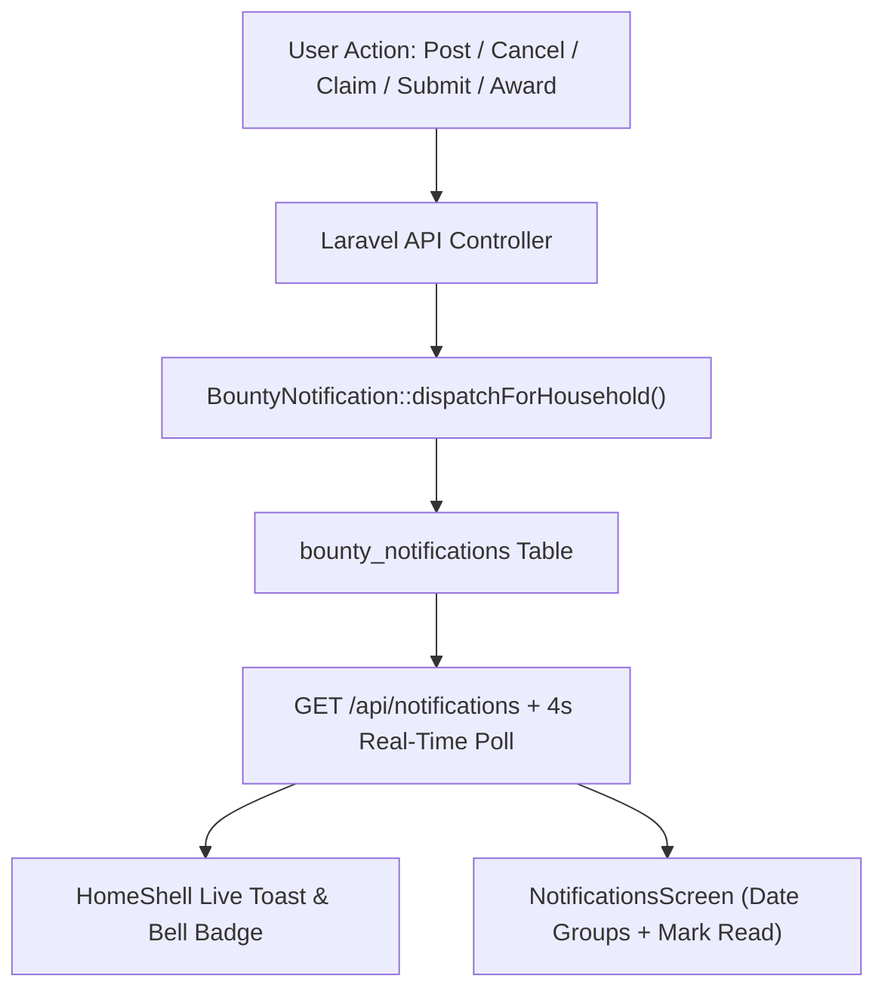

# ChoreBounty System Analysis & Feature Implementation Runbook

**Date:** November 13, 2026  
**Scope:** Laravel 13 REST API (`chore-bounty-api`) & Flutter 3.10 Mobile Client (`chore_bounty_application`)

---

## 1. System Architecture Analysis

ChoreBounty uses a two-tier architecture:
1. **Backend API (`chore-bounty-api`)**: Laravel 13 with Sanctum token authentication, MySQL persistence (`chore_bounty_db`), Eloquent models (`User`, `Household`, `HouseholdUser`, `Bounty`, `BountyClaim`, `BountyCompletion`, `RewardRedemption`, `BountyNotification`), and policy-based authorization (`BountyPolicy`, `HouseholdPolicy`, `UserPolicy`).
2. **Mobile Client (`chore_bounty_application`)**: Flutter 3.10 application using `Dio` (`ApiClient`), `FlutterSecureStorage` (`TokenStorage`), service classes (`AuthService`, `BountyService`, `HouseholdService`), and five primary navigation views inside `HomeShell` (`DashboardView`, `ChoresView`, `LeaderboardView`, `HouseholdView`, `ProfileView`).

### Identified Gaps Addressed by This Runbook
1. **Real-Time Lifecycle Notifications**: The system previously synthesized read-only items from in-memory bounties and lacked persistent event tracking or real-time updates for `posted`, `cancelled`, `claimed`, `submitted`, and `awarded` actions.
2. **Notifications Page Wireframe & Read State**: `NotificationsScreen` lacked date-grouped dividers (`────── Date ──────`), the `Mark all read` header button, circular category icons inside each notification card, and tap-to-mark-read state persistence.
3. **Chore Approval Modal**: Approving a chore in `BountyDetailScreen` showed only a transient snackbar instead of a confirmation modal detailing the approved chore and token reward.
4. **Ready for Approval Section**: Neither `DashboardView` nor `ChoresView` surfaced a dedicated `Ready for Approval` section when a roommate submitted a chore for review.
5. **Chore Details Edit & Delete Rules**: `BountyDetailScreen` and `BountyPolicy` allowed editing/deleting only when `status == 'open'` (including overdue chores) and blocked the creator from editing or deleting a `Taken` (`claimed`) chore.

---

## 2. Feature Specifications & Runbook



### Feature 1: Real-Time Notifications for Posted, Cancel, Claim, Submit, and Award
- **Backend Persistence**:
  - Migration: `database/migrations/2026_11_13_000000_create_bounty_notifications_table.php` creates `bounty_notifications` with `household_id`, `bounty_id`, `user_id`, `actor_id`, `event_type`, `event_name`, `description`, `category`, `is_read`, and `read_at`.
  - Model: `app/Models/BountyNotification.php` provides `dispatchForHousehold()` to fan out notifications to all household members.
  - Event Hooks:
    - **Posted (`posted`)**: `BountyController@store` dispatches `Chore Posted`.
    - **Cancelled (`cancelled`)**: `BountyActionController@cancel` dispatches `Chore Cancelled`.
    - **Claimed (`claimed`)**: `BountyActionController@claim` dispatches `Chore Claimed`.
    - **Submitted (`submitted`)**: `BountyActionController@submit` dispatches `Chore Submitted`.
    - **Awarded (`awarded`)**: `BountyActionController@verify` and `BountyActionController@complete` dispatch `Bounty Awarded`.
  - Endpoints (`app/Http/Controllers/NotificationController.php` & `routes/api.php`):
    - `GET /api/notifications`: Lists household notifications for the authenticated user with `meta.unread_count`.
    - `POST /api/notifications/{notification}/read`: Marks a single notification as read.
    - `POST /api/notifications/read-all`: Marks all notifications in the household as read.
- **Frontend Real-Time Sync**:
  - `lib/models/app_notification.dart` models notification records and provides `deriveFromBounties()` fallback support.
  - `lib/services/bounty_service.dart` implements `notifications()`, `markNotificationRead()`, and `markAllNotificationsRead()`.
  - `lib/screens/home_shell.dart` polls `/api/notifications` and `/api/bounties` every 4 seconds in live runtime, updates the unread badge count on `DashboardHeader`, and displays a floating notification banner when a new event arrives.

### Feature 2: Notifications Page Layout & Mark as Read
- **File**: `lib/screens/notifications_screen.dart`
- **Layout Structure**:
  - **Header**: Back button (`<`), `Notifications` title on the left with seamless canvas background matching the body (`#FAF8F5`), zero elevation, and border below the header removed.
  - **Action Button**: `Mark all read` button styled with solid primary green background (`#1B8354`) and bold white font (`#FFFFFF`).
  - **Date Divider**: Groups notifications by date (`Today`, `Yesterday`, or `MMM D, YYYY`) between subtle `#E2E8F0` divider bars.
  - **Notification Card**: Rounded bordered card styled with consistent `#E2E8F0` 1.2px borders and soft shadow containing:
    - **Left**: Circular icon container (`BoxShape.circle`) with 1.2px `#E2E8F0` border rendering `CategoryIconWidget` for the chore's category.
    - **Right**: `Event Name` on top and `Description` underneath, with an unread dot indicator.
  - **Interaction**: Pressing any notification card immediately marks it as read (`POST /api/notifications/{id}/read`) and updates its visual state. Pressing `Mark all read` marks all notifications as read (`POST /api/notifications/read-all`).

### Feature 3: Chore Approval Confirmation Modal
- **File**: `lib/screens/bounty_detail_screen.dart` (`_handleVerify`)
- **Behavior**:
  - When the chore creator taps `Approve & Disburse Reward`, the app calls `POST /api/bounties/{id}/verify`, refreshes the household state, and presents a modal dialog (`Chore Approved!`).
  - The modal displays the verified badge icon, the approved chore title, the roommate who completed the chore, a `+N Tokens Awarded` pill, and a `Done` button that closes the modal and returns to the previous screen.

### Feature 4: "Ready for Approval" Section in Dashboard and Chore Page
- **Files**: `lib/screens/dashboard_view.dart` & `lib/screens/chores_view.dart`
- **Behavior**:
  - Both screens compute `_readyForApprovalChores` (`_isPostedByMe(b) && b.isSubmitted`).
  - Whenever one or more chores are submitted and awaiting the current user's review, both `DashboardView` and `ChoresView` render the `Ready for Approval` section above the chore list with a count badge and interactive `DashboardBountyCard` items.

### Feature 5: Edit and Delete Chores Only When Available or Taken
- **Backend Policy**: `app/Policies/BountyPolicy.php`
  - `isAvailableOrTaken(Bounty $bounty)` returns `true` only when:
    - `$bounty->status === 'open'` and `$bounty->due_at` is null or in the future (**Available**), OR
    - `$bounty->status` is in `['claimed', 'in_progress']` (**Taken**).
  - `update()` and `delete()` allow the creator to edit or delete a chore only when `isAvailableOrTaken($bounty)` is true, returning `403 Forbidden` for `submitted`, `completed`, `cancelled`, or overdue chores.
- **Frontend Screen**: `lib/screens/bounty_detail_screen.dart`
  - `_buildActionButton()` renders the creator's `Edit`, `Cancel`, and `Delete` action row when `(_bounty.isAvailable || _bounty.isClaimed) && _isCreator`.
  - Hides `Edit` and `Delete` when the chore is `submitted`, `completed`, `cancelled`, or `pastDue`.

### Feature 6: Filter Notifications to Only Show Actions Triggered or Posted by Other Users
- **Backend Enforcement**:
  - `app/Models/BountyNotification.php`: In `dispatchForHousehold()`, the recipient list filters out `$actor->id` (`fn ($id) => (int) $id !== (int) $actor->id`), preventing notification rows from being created for the actor who performed the action.
  - `app/Http/Controllers/NotificationController.php`: `index()` and `markAllAsRead()` enforce `where(fn ($q) => $q->whereNull('actor_id')->orWhere('actor_id', '!=', $user->id))` as a defense-in-depth query filter.
- **Frontend Enforcement**:
  - `lib/models/app_notification.dart`: `isTriggeredBy(userId, userName)` detects self-triggered records. `deriveFromBounties()` excludes self-posted or self-updated bounties when deriving fallback notifications.
  - `lib/services/bounty_service.dart`: `notifications()` accepts `currentUserId` and `currentUserName` and strips self-triggered entries before returning.
  - `lib/screens/notifications_screen.dart`: Filters incoming and initial notification lists so self-triggered entries are never displayed.
  - `lib/screens/home_shell.dart`: Filters notifications for unread badge counts, polling updates, and toast alerts, ensuring notifications and toasts only trigger for other household members' actions.

---

## 3. Verification & Deployment Steps

1. **Backend Database Migration & Tests**:
   ```powershell
   cd d:\www\chore-bounty\chore-bounty-api
   php artisan migrate
   php artisan test
   ```
2. **Frontend Static Analysis & Widget Tests**:
   ```powershell
   cd d:\www\chore-bounty\chore_bounty_application
   flutter analyze
   flutter test
   ```
3. **Emulator Deployment**:
   ```powershell
   cd d:\www\chore-bounty\chore_bounty_application
   flutter build apk --debug --target-platform android-x64
   adb -s emulator-5554 install -r build\app\outputs\flutter-apk\app-debug.apk
   adb -s emulator-5554 shell am start -n com.example.chore_bounty_application/.MainActivity
   ```
