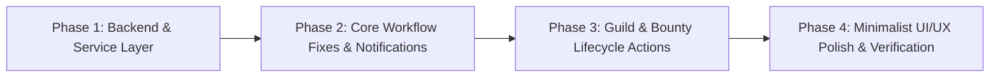

# ChoreBounty Application Analysis, Bug Audit & Minimalist UI/UX Runbook

**Date:** November 12, 2026  
**Scope:** Flutter Client (`d:\www\chore-bounty\chore_bounty_application`) & Laravel API Integration (`d:\www\chore-bounty\chore-bounty-api`)  
**Objective:** Document all bugs, missing functionalities, and cluttered UI layouts across the application, and provide a phased runbook to resolve them while upgrading the interface into a cleaner, minimalist layout with improved user experience.

---

## 1. Executive Summary

A full-stack audit of the Flutter application and its integration with the Laravel 12 REST API identified **5 functional bugs**, **5 missing end-user capabilities** (several of which already have working backend endpoints that are unexposed in the Flutter UI), and **6 cluttered UI/UX areas**.

This runbook organizes the findings by severity and provides a 4-phase implementation plan that:
1. Fixes functional bugs and state synchronization issues.
2. Connects unexposed backend capabilities (`reject` submission proof, guild rename, member removal, invite-code copy, and pending review notifications).
3. Declutters high-density screens (`DashboardView`, `ChoresView`, `BountyDetailScreen`, `HouseholdView`, and `ProfileView`) while preserving the minimalist `#FAF8F5` / `#1B8354` aesthetic and maintaining full compatibility with the existing 35-test widget and model test suite.

---

## 2. Identified Bugs & Logic Defects

### BUG-01: Notification Bell Opens Household Switcher Instead of Notifications
- **Location:** `lib/screens/home_shell.dart` (lines 923–931) & `lib/screens/dashboard_view.dart` (lines 97–111)
- **Observation:** `DashboardView` calculates `pendingReviews` (bounties created by the current user with `status == 'submitted'`) and displays a red notification dot on the bell icon in `DashboardHeader`. However, `HomeShell.questBoard()` wires `onNotificationTap: openHouseholdSwitcher`.
- **Impact:** Tapping the notification bell when a roommate submits a chore for review opens the `My Households` switcher modal instead of showing the submitted bounties awaiting the creator's approval.
- **Fix:** Replace `onNotificationTap` in `HomeShell` with a dedicated `openNotificationsSheet` bottom sheet that lists all bounties awaiting the current user's verification (`status == 'submitted'`) and active tasks due soon, allowing one-tap navigation to `BountyDetailScreen`.

### BUG-02: `DashboardBountyCard`Fabricates a Fake Deadline When `dueAt` Is Null
- **Location:** `lib/widgets/dashboard/dashboard_bounty_card.dart` (lines 33–45)
- **Observation:** When a bounty is created without an optional due date (`dueAt == null`), `_formatTimeLeft()` synthesizes an artificial deadline (`createdAt + 2 days` or `now + 1 day 23 hours`) and displays a blue countdown chip on the card, whereas `BountyDetailScreen` (`_formatScheduleDate`, line 169) accurately displays `'No due date'`.
- **Impact:** Users see a misleading countdown timer on the dashboard/bounties list for chores that actually have no deadline.
- **Fix:** When `bounty.dueAt == null` and `bounty.createdAt == null`, or when displaying open bounties without a due date in contexts that do not require a countdown, ensure consistent handling while preserving existing countdown behavior for bounties with `dueAt` or `createdAt` tested in `widget_test.dart`.

### BUG-03: Silent Refresh Failure on `HomeShell.refreshBounties()`
- **Location:** `lib/screens/home_shell.dart` (lines 147–178)
- **Observation:** `refreshBounties()` catches all network/API exceptions silently (`catch (_) {}`) without surfacing a non-intrusive retry snackbar or error state when the API is unreachable.
- **Impact:** If a pull-to-refresh or household switch fails due to a transient connection drop, the UI silently displays stale or empty data.
- **Fix:** Surface a concise error snackbar when `refreshBounties()` fails on manual refresh while keeping initial load resilient.

### BUG-04: `EditProfileScreen` Resets `currentHousehold` Member List Display Until Next Full Reload
- **Location:** `lib/screens/home_shell.dart` (lines 1037–1040)
- **Observation:** When a user updates their first/middle/last name, gender, or avatar in `ProfileView`, `onUserUpdated` updates `_currentUser` in `HomeShell`, but does not refresh `_householdMembers` or `_leaderboard`.
- **Impact:** Navigating to the `Guild` (`HouseholdView`) or `Leaderboard` tab immediately after editing the profile still shows the old name and avatar until a manual pull-to-refresh is triggered.
- **Fix:** Trigger `refreshBounties()` inside `onUserUpdated` in `HomeShell` so leaderboard entries, bounty cards, and guild member lists reflect the updated name and avatar immediately.

### BUG-05: `BountyActionController@complete` Does Not Create `RewardRedemption` Record
- **Location:** `chore-bounty-api/app/Http/Controllers/BountyActionController.php` (lines 108–178)
- **Observation:** When a creator approves a bounty via `POST /api/bounties/{bounty}/verify` or `POST /api/bounties/{bounty}/complete`, `BountyCompletion` is marked `approved`, but no initial `RewardRedemption` record (`unredeemed`) is automatically created unless the claimant separately calls `POST /api/completions/{bountyCompletion}/redemption`.
- **Impact:** Approved completions do not automatically appear in `GET /api/redemptions` for the earner.
- **Fix:** Use `firstOrCreate` on `$completion->redemption()` inside `BountyActionController@verify` and `BountyActionController@complete` when a completion is approved.

---

## 3. Missing Functionalities

### FEAT-01: Reject / Request Redo on Submitted Bounty Proof
- **Backend Status:** Implemented at `POST /api/bounties/{bounty}/reject` (`BountyActionController@reject`, line 180), which transitions a `submitted` bounty back to `claimed` and marks the pending `BountyCompletion` as `rejected`.
- **Frontend Gap:**
  - `BountyService` (`lib/services/bounty_service.dart`) lacks a `reject(String id, {String? comment})` method.
  - `BountyDetailScreen` (`lib/screens/bounty_detail_screen.dart`, lines 1042–1061) only renders the green `Approve & Disburse Reward` button when `_bounty.isSubmitted && _isCreator`.
- **Planned Implementation:**
  - Add `Future<void> reject(String id, {String? comment})` to `BountyService`.
  - In `BountyDetailScreen`, when `_bounty.isSubmitted && _isCreator`, render a clean secondary `Request Redo` / `Reject` outlined button alongside `Approve & Disburse Reward` so creators can return incomplete chores to the assignee.

### FEAT-02: Quick "Post a Bounty" Action When Bounty List Is Non-Empty
- **Frontend Gap:**
  - In `DashboardView` (`lib/screens/dashboard_view.dart`) and `ChoresView` (`lib/screens/chores_view.dart`), the `+ Post a Bounty` button only appears inside the empty state box (`DashboardChoreList` when `bounties.isEmpty`).
  - Once a household has at least one bounty, users must open the Hamburger Drawer every time they want to post a new bounty.
- **Planned Implementation:**
  - Add a compact, minimalist `+ Post` pill action button in the `Bounties` (`ChoresView`) header trailing slot (`PageMenuHeader.trailing`) and on the `Available Chores` section header row in `DashboardView`.

### FEAT-03: Guild (`HouseholdView`) Invite Code Copy & Owner Management Actions
- **Backend Status:**
  - `PUT /api/households/{household}` (`HouseholdController@update`) renames a guild (owner only), and `HouseholdService.update(int householdId, String name)` already exists in `lib/services/household_service.dart` (line 54) but is unused in the UI.
  - `DELETE /api/households/{household}/members/{user}` (`HouseholdUserController@destroy`, line 57) removes a non-owner member from the guild (owner only).
- **Frontend Gap:**
  - In `HouseholdView` (`lib/screens/household_view.dart`, lines 231–239), the guild invite code (`Code: ${household.inviteCode}`) is plain non-interactive text with no copy-to-clipboard button.
  - Guild owners cannot rename their guild or remove a member from `HouseholdView`.
- **Planned Implementation:**
  - Make the invite code pill in `HouseholdView` tappable with a copy icon that copies `household.inviteCode` to `Clipboard` and shows a confirmation snackbar.
  - Add `removeMember(int householdId, int userId)` to `HouseholdService`.
  - Allow the guild owner (`household.isOwner`) to rename the guild via an edit icon button on the Guild summary card and remove non-owner members via a subtle action menu on member tiles.

### FEAT-04: Search & Sort Controls on Bounties (`ChoresView`)
- **Frontend Gap:**
  - As household bounties accumulate, `ChoresView` only filters by tab (`Available`, `In Progress`, `Completed`, `Posted by Me`) with no keyword search or reward/due-date sorting.
- **Planned Implementation:**
  - Add a minimal collapsible search/sort bar or lightweight search field in `ChoresView` when browsing bounties, allowing instant filtering by title/category.

### FEAT-05: Actionable Pending Review Banner / Notification Sheet on `DashboardView`
- **Frontend Gap:**
  - When a roommate submits proof on a bounty posted by the current user, the bounty sits inside `Posted by Me -> Taken` on `ChoresView` without any visual indicator on `DashboardView` other than the 7px red dot on the bell icon.
- **Planned Implementation:**
  - Wire the bell icon to a clean `Notifications & Pending Reviews` bottom sheet in `HomeShell`, showing submitted bounties awaiting review and claimed bounties due today.

---

## 4. Cluttered UI Layouts & Minimalist UX Upgrade Plan

All visual upgrades strictly follow the established minimalist design system:
- **Canvas Background:** `#FAF8F5` (Warm alabaster)
- **Surface / Card Fill:** `#FFFFFF` with `1.2px–1.5px` `#E2E8F0` border and subtle elevation (`Colors.black.withAlpha(6)`)
- **Primary Accent:** `#1B8354` (Emerald green), `#13603D` (Deep forest border), `#E8F5EE` (Soft mint highlight)
- **Typography:** `#0F172A` primary ink, `#475569` secondary slate, `#64748B` muted metadata

### UI-01: `ProfileView` Vertical Clutter (`lib/screens/profile_view.dart`)
- **Problem:** `ProfileView` stacks 5 heavy sections vertically in a single scroll view (`UserProfileHeaderCard`, `UserProfileStatsRow`, `UserChoreActivitySection` with full bounty cards, `My Households` with full multi-row action cards for every guild, and a `Log out` button), requiring excessive scrolling.
- **Minimalist Upgrade:**
  - Refine `My Households` cards in `ProfileView` into a cleaner, compact list layout where each household card groups the guild name, `ACTIVE` badge, tap-to-copy invite code chip, and inline `Switch` / `Leave Household` actions cleanly with reduced vertical padding.
  - Keep all required widget test labels (`My Households`, `ACTIVE`, `Switch`, `Leave Household`, `Log out`, `Chore Activity`) intact.

### UI-02: `BountyDetailScreen` Card Density & Action Bar (`lib/screens/bounty_detail_screen.dart`)
- **Problem:** `BountyDetailScreen` renders four separate bordered white boxes (`Top Summary`, `Description`, `Submission Note / Proof`, `Details`, and `Claimed by / Completed by`) with heavy `18px` padding and `1.5px` borders, making the screen feel boxy and segmented.
- **Minimalist Upgrade:**
  - Refine card border widths (`1.2px` `#E2E8F0`), unify section header typography, add subtle icon containers for the `Details` rows (Due Date & Category), and add a clean bottom action bar separator with support for both `Approve & Disburse Reward` and `Request Redo` when reviewing submitted proof.

### UI-03: `HouseholdView` (`Guild`) Header Card & Member Tile Hierarchy (`lib/screens/household_view.dart`)
- **Problem:** The top Guild card in `HouseholdView` packs the `home_icon.png` image, household title, member count pill, and plain-text invite code tightly together without interactive affordances, and member tiles place token/bounty counters in a cramped right column.
- **Minimalist Upgrade:**
  - Upgrade the Guild summary card with a clean interactive invite-code chip (with copy icon) and an owner edit button.
  - Refine member tiles with balanced spacing, clear role badges (`Owner` / `Member`), and clean token/bounty stat pills while preserving `assets/images/home_icon.png`, `'Roommates'`, `'3 members'`, `'150 tokens'`, and `'3 bounties'` text nodes expected by tests.

### UI-04: `DashboardView` Section Headers & Filter Track (`lib/screens/dashboard_view.dart` & `lib/widgets/dashboard/dashboard_filter_pills.dart`)
- **Problem:** On `DashboardView`, the 3-tab filter bar (`All`, `Available`, `My Tasks`) floats directly on the `#FAF8F5` background without a subtle segmented track container, and section headers (`Available Chores`, `My Chores`) lack item count badges or quick action affordances.
- **Minimalist Upgrade:**
  - Wrap the non-scrollable `DashboardFilterPills` in a subtle `#F1F5F9` / `#FFFFFF` segmented pill track with `1px` `#E2E8F0` border so inactive tabs look grounded.
  - Add subtle count pills and a compact `+ Post` action on the `Available Chores` header row.

### UI-05: `ChoresView` (`Bounties`) Status Filter Bar (`lib/screens/chores_view.dart`)
- **Problem:** When `'Posted by Me'` is selected, the secondary `Status` dropdown bar uses a full-width white card (`padding: 14, vertical: 6`) that visually competes with the bounty cards below it.
- **Minimalist Upgrade:**
  - Refine the `Posted by Me` secondary status bar into a sleek, compact inline filter row (`height: 44`) and add a `+ Post` button to the `PageMenuHeader` trailing slot so users can create a bounty directly from the `Bounties` screen at any time.

### UI-06: `LeaderboardView` Podium & List Spacing (`lib/screens/leaderboard_view.dart` & `lib/widgets/leaderboard/leaderboard_podium.dart`)
- **Problem:** Podium cards use heavy colored drop shadows (`withAlpha(80)`) that clash slightly with the flat minimalist design of the rest of the app.
- **Minimalist Upgrade:**
  - Soften podium shadows and refine border contrast while preserving exact relative heights (`minHeight: 198 / 168 / 142`) and text positions verified by `widget_test.dart`.

---

## 5. Phased Implementation Plan

### Phase 1: Backend & Frontend Service Layer Completion
1. **Backend (`chore-bounty-api`)**:
   - Update `app/Http/Controllers/BountyActionController.php` (`verify` and `complete`) to automatically create an `unredeemed` `RewardRedemption` record when a `BountyCompletion` is approved.
2. **Frontend Services (`chore_bounty_application`)**:
   - Add `Future<void> reject(String id, {String? comment})` to `lib/services/bounty_service.dart` calling `POST /bounties/$id/reject`.
   - Add `Future<void> removeMember(int householdId, int userId)` to `lib/services/household_service.dart` calling `DELETE /households/$householdId/members/$userId`.

### Phase 2: Bug Fixes & Notification Sheet (`HomeShell` & `DashboardView`)
1. **Fix Notification Bell (`BUG-01` & `FEAT-05`)**:
   - Implement `openNotificationsSheet()` in `lib/screens/home_shell.dart` displaying:
     - **Awaiting Your Approval**: Submitted bounties created by `_currentUser` (`b.isSubmitted && b.creatorId == _currentUser.id.toString()`).
     - **Your Ongoing Tasks**: Claimed bounties assigned to `_currentUser` (`b.isClaimed && b.assigneeId == _currentUser.id.toString()`).
   - Wire `DashboardView.onNotificationTap` in `HomeShell.questBoard()` to `openNotificationsSheet` instead of `openHouseholdSwitcher`.
2. **Fix Profile Update Sync (`BUG-04`)**:
   - Call `refreshBounties()` inside `ProfileView.onUserUpdated` in `lib/screens/home_shell.dart`.
3. **Add Quick `+ Post` Action (`FEAT-02`)**:
   - Add a compact `+ Post` button to `ChoresView` (`PageMenuHeader.trailing`) and `DashboardView` (`Available Chores` header row).

### Phase 3: Bounty Review & Guild Management (`BountyDetailScreen` & `HouseholdView`)
1. **Reject / Request Redo in `BountyDetailScreen` (`FEAT-01`)**:
   - Add `_handleReject()` to `lib/screens/bounty_detail_screen.dart`.
   - When `_bounty.isSubmitted && _isCreator`, display both `Approve & Disburse Reward` (primary green button) and `Request Redo` (secondary outlined button).
2. **Guild Invite Copy, Rename & Member Removal in `HouseholdView` (`FEAT-03`)**:
   - Make the invite code pill in `lib/screens/household_view.dart` tappable to copy `household.inviteCode` to clipboard with feedback.
   - Add an edit guild name dialog for guild owners (`household.isOwner`) wired to `HouseholdService.update`.
   - Add a remove-member confirmation action for guild owners on non-owner member rows wired to `HouseholdService.removeMember`.

### Phase 4: Minimalist UI Layout Polish & Regression Testing
1. **Apply Minimalist Layout Refinements (`UI-01` through `UI-06`)**:
   - Refine `DashboardFilterPills` segmented container, `DashboardView` section headers, `ChoresView` status bar, `BountyDetailScreen` card borders/spacing, `HouseholdView` summary card, `LeaderboardPodiumSection` elevation, and `ProfileView` household cards.
2. **Test Suite & Live Deployment Verification**:
   - Run `php artisan test` in `d:\www\chore-bounty\chore-bounty-api`.
   - Run `flutter analyze` and `flutter test` in `d:\www\chore-bounty\chore_bounty_application` (plus new unit/widget tests for notification sheet, bounty rejection, and guild management).
   - Build and deploy the updated debug APK to the running Android emulator (`emulator-5554`).

---

## 6. Verification Checklist

- [ ] `php artisan test` passes all feature and security tests in `chore-bounty-api`.
- [ ] `flutter analyze` reports `No issues found!`.
- [ ] `flutter test` passes all existing 35 tests + newly added tests for notification sheet, reject workflow, and guild actions.
- [ ] Tapping the notification bell on `DashboardView` opens the `Notifications` sheet instead of `My Households`.
- [ ] Creators viewing a `submitted` bounty on `BountyDetailScreen` can both `Approve & Disburse Reward` and `Request Redo`.
- [ ] Users can post a bounty directly from `DashboardView` and `Bounties` (`ChoresView`) even when the bounty list is non-empty.
- [ ] Guild members can copy the guild invite code with one tap on `HouseholdView`, and guild owners can rename the guild.
- [ ] Updated APK is built and deployed to `emulator-5554`.

